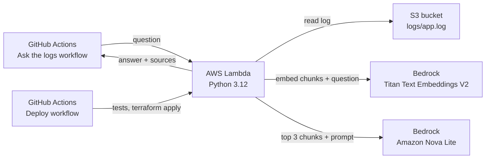

# Log RAG Assistant (AWS Bedrock + Lambda + Terraform + GitHub Actions)

**Problem:** during an incident, engineers scroll through hundreds of log lines to find what broke and why.
**What I built:** a small AI assistant that answers questions about a log file in plain English, such as
"Why did payments-api return 503 errors and what fixed it?". It finds the relevant log lines first
(retrieval-augmented generation, RAG) and answers only from those lines, quoting timestamps.

## Architecture

| Part | What it does |
| --- | --- |
| `app/rag.py` | Splits the log into overlapping 15-line chunks and ranks them by similarity |
| `app/handler.py` | Lambda: embeds chunks with Titan, picks the top 3, asks Nova to answer from them only |
| `infra/` | Terraform: S3 bucket, Lambda, least-privilege IAM role, CloudWatch log group |
| `.github/workflows/deploy.yml` | CI/CD: runs unit tests, then `terraform plan` and `apply` on every push to `main` |
| `.github/workflows/ask.yml` | Ask a question from the GitHub UI; the answer appears in the run summary |
| `.github/workflows/destroy.yml` | Deletes all AWS resources with one click |
| `tests/` | Unit tests for chunking and retrieval |

**Guardrails in the prompt:** the model must answer only from the log excerpts, quote timestamps, and
say "I could not find this in the logs" instead of guessing.

---

## Setup guide (about 2 to 3 hours, nothing to install)

You only need a web browser, a GitHub account and an AWS account. Terraform and the tests run inside
GitHub Actions, and the Python code runs on Lambda (which already includes `boto3`).

### 1. Put the code on GitHub (15 min)

1. On GitHub, click **New repository**, name it `log-rag-assistant`, make it **Public**, tick **Add a README**, create it.
2. Click **Add file > Upload files** and drag in everything from the unzipped folder, including the
   `.github` folder. Commit to `main`.
3. To edit code in VS Code without installing anything, open your repo and press the **`.`** key.
   This opens **github.dev**, VS Code in the browser.

> If the `.github` folder doesn't upload (Windows sometimes hides it), create the three files in
> github.dev under `.github/workflows/` and paste in their contents.

The first **Deploy** run will fail because the secrets aren't set yet. That's expected.

### 2. Check Bedrock access (10 min)

1. In the AWS console, make sure the region (top right) is **Asia Pacific (Sydney) ap-southeast-2**.
2. Open **Amazon Bedrock > Playgrounds > Chat**, pick **Amazon Nova Lite**, and send "hello".
3. If you see an access message, open **Model access** in the Bedrock menu and enable
   **Nova Lite** and **Titan Text Embeddings V2**.

### 3. Create the Terraform state bucket (5 min)

Terraform needs somewhere to remember what it created between runs.

1. Open **S3 > Create bucket** in Sydney (ap-southeast-2).
2. Name it something unique, such as `kv-tfstate-<random numbers>`. Keep the defaults (public access blocked).

### 4. Create AWS keys for GitHub Actions (10 min)

1. Open **IAM > Users > Create user**, name it `github-deployer`.
2. Choose **Attach policies directly** and pick **AdministratorAccess** (fine for a personal lab; delete the user when you're done).
3. Open the user, go to **Security credentials > Create access key**, choose **Third-party service**, and copy both keys.

### 5. Add GitHub secrets (5 min)

In your repo: **Settings > Secrets and variables > Actions > New repository secret**. Add three:

| Name | Value |
| --- | --- |
| `AWS_ACCESS_KEY_ID` | Access key from step 4 |
| `AWS_SECRET_ACCESS_KEY` | Secret key from step 4 |
| `TF_STATE_BUCKET` | Bucket name from step 3 |

### 6. Deploy (10 min)

Go to **Actions > Deploy > Run workflow**. You should see the unit tests pass, then Terraform create
about 9 resources. After this, every push to `main` redeploys automatically.

### 7. Ask questions (fun part)

Go to **Actions > Ask the logs > Run workflow**, type a question and run it. Open the finished run to
see the answer and the log lines it used. Try:

- Why did payments-api return 503 errors and what fixed it?
- Which pod was OOMKilled and how was it resolved?
- Was there any TLS certificate issue?
- Did the nightly reconciliation job succeed?
- What was the Kafka consumer lag during the incident?
- Was there a disk full error? *(It should say it couldn't find this. That's the guardrail working.)*

Take screenshots of a good answer and the green Deploy run, and add them to this README.

### 8. Clean up (5 min)

1. **Actions > Destroy > Run workflow**, type `destroy`.
2. Delete the `github-deployer` IAM user and the state bucket.

**Cost:** Lambda and S3 stay within the free tier. Bedrock costs a fraction of a cent per question.

---

## Ideas to extend it

- Switch GitHub Actions to **OIDC** so no long-lived AWS keys are stored.
- Upload your own log files to the S3 bucket and pass `log_key` in the payload.
- Swap the model by changing `chat_model_id` in `infra/variables.tf`.
